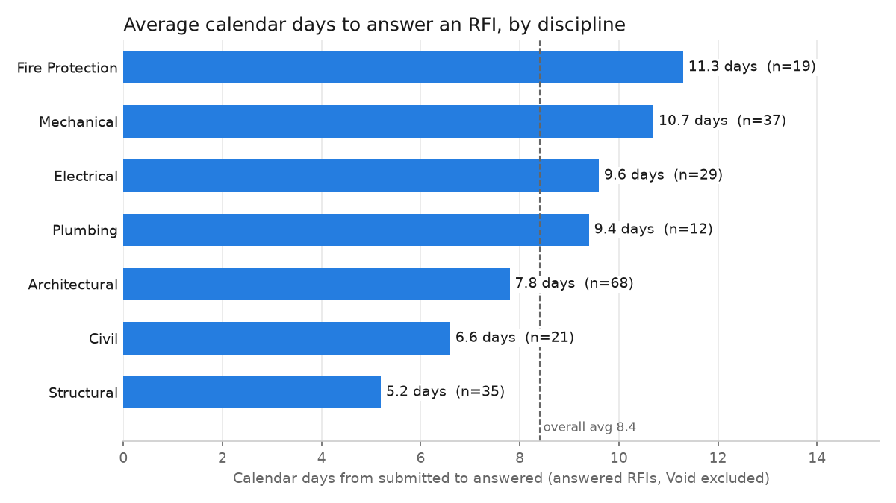

# RFI Log Analysis: Canyon View Medical Office Building

**Data:** `rfi_log.csv`, 250 RFIs, exported October 30, 2026 (all data is synthetic)
**Script:** `rfi_analysis.py` · **Tables:** `outputs/`

## How the numbers were calculated

- **Calendar days** throughout. Weekends and holidays count.
- **Void RFIs are excluded** from every measure (12 RFIs). That leaves 238 RFIs: 221 Closed and 17 Open.
- **"As of" date** is the export date, October 30, 2026.
- **Past due** means the RFI is Open and its `date_required` is *before* October 30. An RFI due on the 30th itself is not counted as late.
- **Data quality:** no problems found. Every Closed RFI has an answer date, no answer comes before its submit date, and every due date matches the priority rule (High 3, Medium 7, Low 10 days).

## Key findings

1. **The typical RFI takes about a week to answer, but more than half are answered late.** Across 221 answered RFIs, the average is 8.4 days and the median is 6 days. 118 of them (53%) came back after their due date.
2. **MEP is the bottleneck.** Fire Protection, Mechanical, Electrical and Plumbing RFIs take 9–11 days on average, compared with 5–8 days for Structural, Civil and Architectural. The MEP Engineer is late on 71% of its answers and accounts for 16 of the 17 RFIs still open.
3. **13 open RFIs are past due, and 12 of them sit with the MEP Engineer.** Nine have been overdue for 100 days or more. The oldest, RFI-079 (Electrical), was due April 2, 2026 and is 211 days overdue.
4. **The Owner is slowest, but on few RFIs.** It averages 17.2 days, with one answer taking 42 days. This is based on only 8 RFIs, so treat it with caution.
5. **RFI volume peaked in May 2026 at 32,** compared with a monthly average of about 20. Volume has stayed steady at 18–25 a month since then.

## 1. Days to answer

| Assigned to | Answered | Avg days | Median days | Answered late | Still open |
|---|---:|---:|---:|---:|---:|
| Owner | 8 | 17.2 | 11 | 88% | 0 |
| MEP Engineer | 93 | 10.2 | 9 | 71% | 16 |
| Architect | 66 | 7.0 | 5 | 41% | 1 |
| Civil Engineer | 21 | 6.6 | 5 | 29% | 0 |
| Structural Engineer | 33 | 5.0 | 4 | 36% | 0 |

For Architectural and Owner RFIs, the average is well above the median. That means a few very slow answers are pulling the average up; most RFIs in those groups are answered faster than the average suggests.

The full tables are in `outputs/days_to_answer_by_discipline.csv` and `outputs/days_to_answer_by_assignee.csv`.

## 2. Open RFIs past due (as of October 30, 2026)

Of the 17 open RFIs, 13 are past due and 4 are not yet due.

| RFI | Discipline | Assigned to | Priority | Due | Days overdue |
|---|---|---|---|---|---:|
| RFI-079 | Electrical | MEP Engineer | Low | 2026-04-02 | 211 |
| RFI-093 | Mechanical | MEP Engineer | Low | 2026-04-23 | 190 |
| RFI-124 | Fire Protection | MEP Engineer | Medium | 2026-05-20 | 163 |
| RFI-122 | Mechanical | MEP Engineer | Low | 2026-05-22 | 161 |
| RFI-139 | Mechanical | MEP Engineer | Medium | 2026-06-03 | 149 |
| RFI-145 | Mechanical | MEP Engineer | Medium | 2026-06-11 | 141 |
| RFI-155 | Mechanical | MEP Engineer | Medium | 2026-06-22 | 130 |
| RFI-158 | Plumbing | MEP Engineer | Low | 2026-07-02 | 120 |
| RFI-176 | Mechanical | MEP Engineer | Medium | 2026-07-22 | 100 |
| RFI-224 | Electrical | MEP Engineer | Medium | 2026-09-24 | 36 |
| RFI-233 | Electrical | MEP Engineer | Medium | 2026-10-09 | 21 |
| RFI-243 | Electrical | MEP Engineer | Low | 2026-10-29 | 1 |
| RFI-248 | Architectural | Architect | High | 2026-10-29 | 1 |

RFI-124 may be a repeat question. It has the same subject ("Fire riser room clearance") as RFI-104, 110 and 118, which were all submitted by the same company within the previous 14 days and are now closed. See `outputs/dup_possible_questions.csv`. It may only need to point to one of those answers.

The full list, with subject, company and impact, is in `outputs/open_rfis_past_due.csv`.

## 3. RFIs submitted per month

| Month | Closed | Open | Total |
|---|---:|---:|---:|
| Nov 2025 | 5 | 0 | 5 |
| Dec 2025 | 17 | 0 | 17 |
| Jan 2026 | 18 | 0 | 18 |
| Feb 2026 | 13 | 0 | 13 |
| Mar 2026 | 23 | 1 | 24 |
| Apr 2026 | 23 | 1 | 24 |
| May 2026 | 29 | 3 | 32 |
| Jun 2026 | 21 | 3 | 24 |
| Jul 2026 | 18 | 1 | 19 |
| Aug 2026 | 25 | 0 | 25 |
| Sep 2026 | 17 | 1 | 18 |
| Oct 2026 | 12 | 7 | 19 |
| **Total** | **221** | **17** | **238** |

November 2025 is low because work started on November 3. October 2026 has the most open RFIs because many were submitted only days before the export date.

## Limitations

- Open RFIs have no answer time yet, so the "days to answer" figures understate how slow the MEP Engineer really is.
- The possible duplicate RFIs found earlier are still included. Confirming them would need the full question text, which is not in the log.
